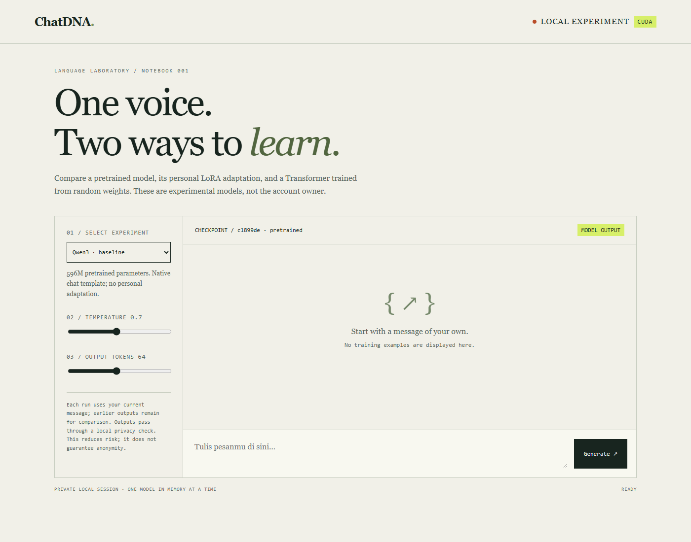
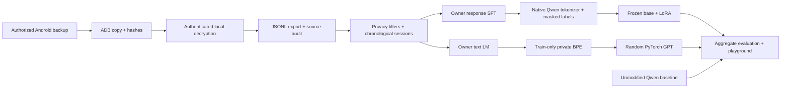

# ChatDNA

A local learning project with two independent, completed training paths: **response-only LoRA adaptation of Qwen3-0.6B**, and a **decoder-only GPT implemented in PyTorch and trained from random weights**. It includes a validated WhatsApp pipeline, aggregate evaluations, private checkpoints, and a local comparison playground.

The experiments demonstrate working training and lower held-out loss. They do not yet produce a reliable personal chatbot. The pretrained baseline remains default: adaptation regressed on small general instruction probes, while scratch often ends prematurely.



Read the [final report](docs/FINAL_REPORT.md), [learning log](docs/LEARNING_LOG.md), [experiment ledger](docs/EXPERIMENTS.md), [architecture](docs/ARCHITECTURE.md), [dataset protocol](docs/DATASET.md), and [actual WhatsApp acquisition procedure](docs/WHATSAPP_ACQUISITION.md).



## Measured results

- Source: 3,493,665 records; 254,864 owner messages survive message-level cleaning.
- Owner LM documents: **128,853 / 22,000 / 18,474** train/validation/test. Training corpus: **1,251,457 BPE body tokens**, or 1,380,310 predicted tokens including EOS.
- Direct-chat SFT: **27,769 / 14,959 / 8,309** examples. The 128-token Qwen policy accepts 27,576 training samples/268,209 target tokens. Pilot reservoir: 5,000 samples; each 100-step run actually trained **3,899 target tokens**.
- Qwen base: **596,049,920** parameters; LoRA: **1,146,880** trainable. A1 validation NLL **7.6456 → 5.2094**. Lower-LR variant: **5.7206**, less repetition but no recovery on general probes.
- Scratch: **2,587,776** random-initialized parameters. The 2,000-step GPU run trained **166,249** target tokens in **64.19 s**; validation NLL **8.3498 → 6.3260**. Generation is still weak.
- **24 tests passed**, actual checkpoint-resume runs, three-model HTTP inference and desktop/mobile browser QA. Private artifacts stay outside Git.

Losses use different tokenizers/objectives. Compare changes within each track. Full costs and negative generation findings are in the report.

## Install

Use Python 3.12. Measured hardware: i5-11300H, 16 GiB RAM, RTX 3050 Laptop GPU with 4 GiB VRAM. GPU runs used torch 2.11.0+cu128; the separate CPU pilot used torch 2.14.1+cpu. Lock files record both environments. Select one:

```powershell
python -m venv .venv
.\.venv\Scripts\Activate.ps1
python -m pip install -r requirements-cuda.lock
# CPU alternative: python -m pip install -r requirements-cpu.lock
python -m pip install --no-deps -e .
python -m pytest -q
python -m chatdna.cli hardware
python scripts/check_staged.py
```

The real-Qwen-tokenizer test skips until public model files exist. Set `CHATDNA_TOKENIZER_PATH` to that local model directory to run all 24 tests. Browser QA additionally needs `pip install -e ".[browser-test]"` and installed Edge. Public package/model downloads need network access; private preparation, training and inference use local files.

## Prepare and train

Run from the `chatdna/` project folder inside the sandbox checkout. Set the private paths to directories outside the monorepo; the example below creates a separate sibling artifact layout. The export and decrypted backup must already exist there, following the acquisition guide. Choose new run names to preserve completed experiments. No private data or trained weights are included in this repository.

```powershell
$privateRoot = [IO.Path]::GetFullPath('..\..\chatdna-private')
$exportRoot = Join-Path $privateRoot 'whatsapp-export'
$databaseFile = Join-Path $privateRoot 'backups/msgstore.db'
python scripts/download_model.py --output "$privateRoot/models/qwen3-0.6b"
python -m chatdna.cli prepare --export "$exportRoot" --source-db "$databaseFile" --output "$privateRoot/dataset-rebuild" --participant-context-authorized --config configs/data.json
python -m chatdna.cli validate --dataset "$privateRoot/dataset-rebuild"
python -m chatdna.cli tokenize --dataset "$privateRoot/dataset-rebuild" --output "$privateRoot/bpe-rebuild" --vocab-size 4096 --block-size 128
python scripts/run_b0.py --output "$privateRoot/runs/b0-new"
python -m chatdna.cli train-scratch --data "$privateRoot/bpe-rebuild" --output "$privateRoot/runs/b1-new" --config configs/scratch/longer.json
python -m chatdna.cli train-lora --model "$privateRoot/models/qwen3-0.6b" --data "$privateRoot/dataset-rebuild" --output "$privateRoot/runs/a1-new" --config configs/finetune/conservative.json
```

Completed runs used `dataset-v3` and `bpe-v1`. A cached v4 rebuild with the current default policy reproduced all six prepared file counts and SHA-256 hashes and passed independent validation. Identical pseudonymous file hashes require the same private identity salt; a new salt changes identifiers/hashes. GPU kernels and library versions can change numerical results.

Resume uses **absolute total steps**, not extra steps. Extending the horizon changes the cosine schedule; these prove state restoration, not uninterrupted bit-for-bit equivalence:

```powershell
python -m chatdna.cli train-scratch --data "$privateRoot/bpe-v1" --output "$privateRoot/runs/b1-resume-new" --config configs/scratch/small.json --resume "$privateRoot/runs/b1/checkpoint.pt" --steps 201
python -m chatdna.cli train-lora --model "$privateRoot/models/qwen3-0.6b" --data "$privateRoot/dataset-v3" --output "$privateRoot/runs/a1-resume-new" --config configs/finetune/small.json --resume "$privateRoot/runs/a1/adapter" --steps 101
```

## Evaluate and open the playground

The original private selection manifest retains `a1-conservative` and `b1-longer`; baseline stays default. Evaluation commands below refer to the original `dataset-v3`/`bpe-v1`/run-name layout. For newly named runs, point your private registry at those artifacts; the helper defaults to the original layout. The registry helper also creates a private hashed memorization guard.

```powershell
python scripts/create_registry.py --private-root "$privateRoot"
python scripts/evaluate_models.py --registry "$privateRoot/registry.json" --dataset "$privateRoot/dataset-v3" --output "$privateRoot/validation-new.json" --split validation --temperature .7
python scripts/evaluate_models.py --registry "$privateRoot/registry.json" --dataset "$privateRoot/dataset-v3" --output "$privateRoot/continuations-new.json" --scratch-continuations
python scripts/summarize_dataset.py --private-root "$privateRoot" --output "$privateRoot/analysis-new.json"
python scripts/evaluate_scratch_objective.py --private-root "$privateRoot" --output "$privateRoot/objective-new.json"
python scripts/build_report.py --private-root "$privateRoot"
python -m chatdna.cli serve --registry "$privateRoot/registry.json" --port 8765
```

Open **http://127.0.0.1:8765**. It loads one model at a time and displays model/checkpoint, temperature, length, token count and latency. Each request uses the current message only; earlier outputs remain for comparison. It identifies output as model text. The server binds to loopback, validates Host/Origin and a session token, and does not log request bodies or send WhatsApp messages.

For scratch, open **http://127.0.0.1:8765/#scratch** for the **sentence finisher**. Write a sentence beginning such as `hari ini aku`, then press Continue. The prefix and highlighted continuation appear together; Keep writing copies the combined text into the input for another continuation. Prefix spacing is preserved. Empty generations show a stopping notice without inventing text. This uses the same owner-text continuation checkpoint and decoding settings; it does not retrain the model or suppress EOS. Premature stopping can still occur.

In a second terminal:

```powershell
python scripts/smoke_playground.py --output docs/PLAYGROUND_TEST.json
python scripts/smoke_browser.py --output docs/figures
```

## Privacy and limitations

The owner confirmed all-participant processing/training permission on 28 October 2026. SFT still supervises owner responses; scratch uses owner text. Messages, contacts, keys, databases, learned private tokenizers, salted mappings, checkpoints and adapters remain untracked. No private uploads or external inference services were used.

Redaction and overlap checks reduce risk; they do not establish anonymity, eliminate memorization or replace review before publication. Names, locations and sensitive facts may survive. Before every commit run `python scripts/check_staged.py`; the local hook enforces the same check without printing flagged values.

The optional hook can be enabled from the monorepo root with `git config --local core.hooksPath chatdna/.githooks`. This changes the hook setting for the whole checkout, so integrate it with any existing monorepo hooks rather than replacing them unintentionally. Manual staged checks work from either the monorepo root (`python chatdna/scripts/check_staged.py`) or this project folder.

This folder imports the reviewed source snapshot from the original standalone project. See [publication notes](docs/PUBLICATION.md) for what is included and excluded.

Larger A2/B2, recency/context ablations, multi-seed sweeps and blinded human relevance/preference studies were not run. Character overlap and three simple probes cannot establish personal style learning.

## Provenance

Track A uses [Qwen/Qwen3-0.6B](https://huggingface.co/Qwen/Qwen3-0.6B), revision `c1899de289a04d12100db370d81485cdf75e47ca`, under **Apache-2.0**. Native chat template, thinking disabled; sampling temperature .7/top-p .8/top-k20 follows its non-thinking guidance. Track B uses no pretrained weights. Framework/package licenses apply; private weights are not distributed with this repository.
