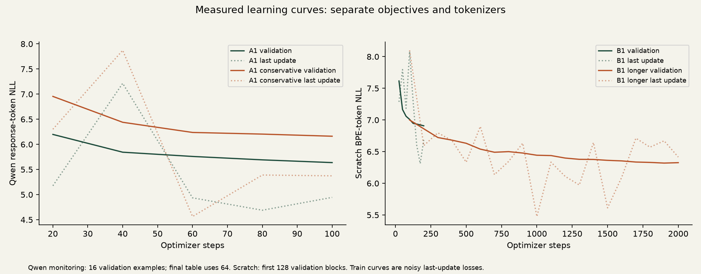
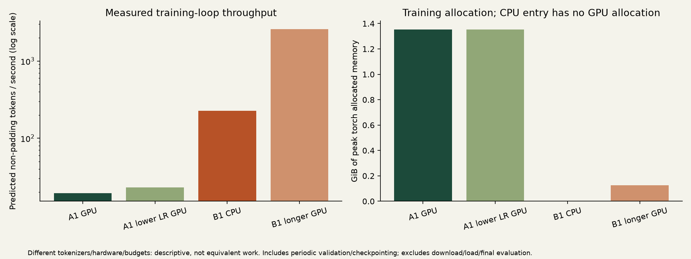

# Experiment ledger — 28 October 2026

All results below are completed local measurements. Dataset v3 was trained; current-policy cached v4 reconstruction reproduced all six prepared file counts and SHA-256 hashes. Seeds are 42 except B0 (7). There is no multi-seed statistical estimate.

## Available data and consumed data

Owner LM train/validation/test: 128,853 / 22,000 / 18,474 documents. Train-only BPE vocabulary 4,096, context 128. Training has 1,251,457 body tokens, 1,380,310 predicted tokens including EOS, and 130,873 padded windows. Direct-chat SFT: 27,769 / 14,959 / 8,309 examples. Qwen length policy accepts 27,576 train samples/268,209 target tokens; deterministic reservoir 5,000 samples/48,975 targets. Training samples with replacement rather than traversing the full corpus.

## Completed runs

| Experiment | Trainable parameters | Configuration | Outcome |
|---|---:|---|---|
| B0 | 7,656 | CPU; 100 steps; 400 synthetic tokens; LR .02 | NLL 2.638861 → .000252; exact synthetic greedy continuation |
| A0 | 0 | Frozen 596,049,920-parameter Qwen baseline | Val NLL 7.645573; test 7.890690 |
| A1 | 1,146,880 | BF 16 GPU; q/v rank 8, alpha 16, dropout .05; LR 2e-4; 100 steps; micro 1 × accumulation 4 | Val 5.209436; repetitive generation and general-probe regression |
| A1 conservative | 1,146,880 | Same seed/data/steps, LR 5e-5 | Val 5.720573; less repetition; general probes still regressed |
| B1 | 2,587,776 | Random GPT; CPU; 4 layers, 6 heads, width 192, context 128, dropout .1; LR 3e-4; micro 4 × accumulation 2; 200 steps | Val 8.349849 → 6.908167; greedy outputs mostly EOS/whitespace |
| B1 longer | 2,587,776 | Fresh random seed 42; same architecture; 2,000 steps on GPU | Val 8.349849 → 6.325969; body prediction improves, output remains weak |
| A1 resume | 1,146,880 | Adapter, optimizer, scaler and RNG restored; step 100→101 | 52 targets; 3.50s; val 5.207472 |
| B1 resume | 2,587,776 | Model, optimizer and RNG restored; step 200→201 | 49 targets; 1.59s; restored val 6.908167, final 6.908226 |

Exact training-loop costs, test NLL and allocated memory: [RESULTS_TABLE.md](RESULTS_TABLE.md). Full configurations/history are in the corresponding `*_RESULTS.json`. B0/resume verify mechanics. Resume extends the scheduling horizon; bit-for-bit equivalence to uninterrupted training is not claimed. Qwen resume's baseline_validation is the unadapted base; scratch's field is the loaded checkpoint.

Train curves show the last optimizer update, not epoch means. Qwen periodic validation uses 16 examples; final loss uses 64 examples/596 targets; test 64/669. Scratch periodic/final validation uses the first 128 blocks/1,771 targets; test 128/2,284. These budgeted subsets are not full-held-out estimates. The extra uniform 512-block diagnostic reduces reliance on one early slice.

## Generation evaluation and selection

Initial pilot evaluation used 12 held-out test prompts, greedy decoding. It exposed repetition/EOS failures, recorded as exploratory in GENERATION_PILOT_TEST.json. Since it informed further work, that tiny test subset is no longer a pristine final benchmark. Later variants used validation, same reservoir seed 42, max 32 tokens, temperature .7; Qwen top-p .8/top-k20, scratch top-k40. Generation sees the last incoming turn; loss sees the available multi-turn context. These settings measure different behavior.

| Validation sampling | Character overlap proxy | Repeated trigram rate | Empty /12 | General probes /3 |
|---|---:|---:|---:|---:|
| Qwen baseline | .1365 | .0000 | 0 | 3 |
| A1 | .1966 | .2292 | 0 | 1 |
| Conservative LoRA | .1676 | .0370 | 0 | 0 |
| B1 | .0375 | .0000 | 7 | 0 |
| B1 longer | .0488 | .0000 | 8 | 0 |

Three synthetic probes cover elementary arithmetic, sequence completion and greeting translation. They catch regressions but do not establish general capability. Character overlap/slang markers are unvalidated style proxies; semantic relevance, humor, preference and blinded human comparison remain unmeasured. No privacy suppression occurred on these few requests; that does not prove absence of memorization.

Selection retains conservative LoRA for lower repetition and longer scratch for lower native validation loss. Neither is promoted over baseline. Test NLL is emitted automatically by training, but no new test score was used to choose variants. Baseline remains recommended/default.

## What scratch learned

On 512 uniformly spaced validation blocks (6,280 targets:5,773 body +507 EOS), body NLL improves **8.3443 random → 7.3192 B1 → 6.7515 longer**. Improvement is not entirely EOS learning. However, EOS is argmax on **63.1% → 53.9%** of body positions. Greedy premature stopping remains substantial. With native owner-text prefixes, longer scratch returns nonempty text on only 1/12 greedy and 5/12 temperature-.8 continuations. See SCRATCH_OBJECTIVE.json and SCRATCH_CONTINUATIONS.json.

## Cost and limits

Training-loop times include periodic validation/checkpointing; they exclude setup, public downloads, loading and final evaluation. The four main loops total about 8.4 minutes; B0/resume add seconds. Public CUDA installation alone took about 39m22s. GPU peak is torch allocated memory, not total driver usage, reserved memory or available VRAM. No paid compute was used.

B1 CPU used torch 2.14.1+cpu; GPU runs torch 2.11.0+cu 128. Hardware/version/horizon changed together, so B1 comparisons are not a controlled GPU speedup or pure duration ablation. Different output lengths affect latency; empty EOS output is not superior inference.

## Failures and repairs

Wrong-order key OCR failed decryption; visual verification and GCM authentication repaired acquisition. Repeat filtering initially conflated speakers, then was narrowed to same-speaker bursts. Merged turns were rescanned for credentials spanning messages. Public model transfer stalled; pinned resumable HTTPS verified LFS size/hash. Missing chat-template dependencies were installed and locked. Windows default decoding corrupted registry labels, repaired with explicit UTF-8. Browser QA initially used a CSP-blocked evaluation string; locator assertions fixed the harness while preserving CSP. Server handling now tolerates clients disconnecting during generation.

Quality failures remain visible. Larger A2/B2, recent-data/context/rank ablations, full-held-out evaluation and blinded human preference are deferred. They are not required to establish the two working educational training paths, and they are not claimed complete.
