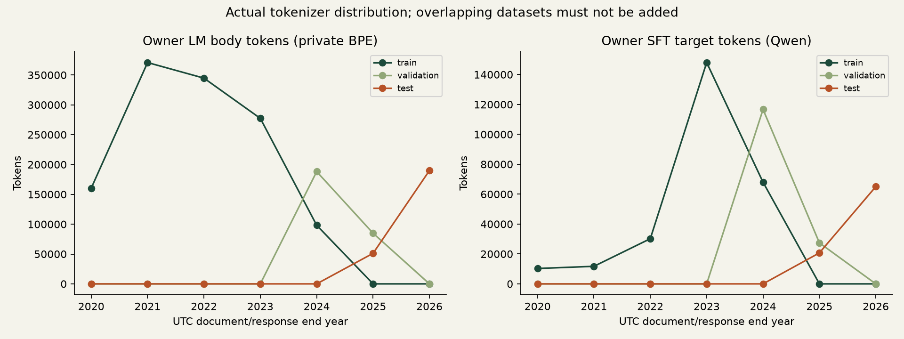

# ChatDNA — final learning and experiment report

Completed locally on 28 October 2026. The educational implementation is complete: authorized-data preparation, two genuinely independent model tracks, real training/evaluation, private checkpoints, local UI, tests and incremental Git history. The personal chatbot quality goal remains experimental. Baseline Qwen is recommended; neither trained variant has demonstrated better overall conversation quality.

## 1. How much source data was usable?

The authenticated Android backup exported 3,493,665 message records. The source audit found 2,940,539 plain-text messages: 256,887 outgoing and 2,683,652 others. Owner identity uses `from_me=true`; sender row zero is a placeholder and no phone/LID identity was guessed. Observed sender identifiers number 4,599, not necessarily distinct humans. The source spans July 2018–October 2026; the eligible cleaned personal corpus begins in 2020. These are different populations.

Message-level cleaning retains **254,864 owner messages and 2,658,841 other messages**, before burst filtering and turn-level rejection. All-participant processing/training permission was explicitly confirmed by the owner. Scratch uses owner text; SFT uses permitted participant context and supervises owner responses. Group adjacency is excluded from initial SFT. The source audit's 142,395 candidate turn pairs are not interchangeable with the builder's final direct-chat examples.

Audit categories include 273,665 media-only and 169,311 system records; other categories are retained in the source export rather than silently turned into prose. Logical duplicate rate is 0%; repeated normalized wording is 20.56%, which is not automatic data corruption. Original ID order has 22,021 backward timestamp steps and one invalid timestamp. Reconstruction sorts per chat by timestamp then source ID; invalid/unresolved events form context barriers. No message bodies were printed or uploaded during this project.

## 2. How many examples and training tokens remained?

| Dataset unit | Train | Validation | Test |
|---|---:|---:|---:|
| Owner LM documents | 128,853 | 22,000 | 18,474 |
| Private BPE body tokens | 1,251,457 | 272,973 | 241,070 |
| Predicted BPE tokens including EOS | 1,380,310 | 294,973 | 259,544 |
| Padded LM windows | 130,873 | 22,465 | 18,840 |
| Direct-chat SFT examples | 27,769 | 14,959 | 8,309 |
| Qwen examples after length policy | 27,576 | 14,844 | 8,184 |
| Qwen target tokens after length policy | 268,209 | 144,061 | 85,743 |

SFT/LM overlap in source content and must not be added as unique messages. Audit `o200k_base` counts (30,657,752 overall, 2,654,182 outgoing) differ from these actual model-token counts. BPE vocabulary 4,096 was learned from training only. Qwen's existing tokenizer was retained. No language/code-switching distribution is claimed without a validated classifier.

The A1 pilot reservoir contains 5,000 examples/48,975 targets; validation/test reservoirs contain 256 each, but final loss evaluates 64 each. Each 100-step LoRA run actually consumes 3,899 targets, with replacement. B1 consumes 15,781 targets; longer B1 consumes 166,249, about 12% of the training corpus's target-token count, also with replacement. These are small pilots, not whole-corpus epochs.

Clean owner message length has BPE mean 6.70, median 4, p90=9, p95=12, p99=62. LM train turn median 5, mean 9.71, p99=108; held-out turns have median 7. Qwen train sequence median 46, p90=77, p99=111, target median 8. Exact repeated owner texts number 169,297 out of 254,864 messages; top 10 wording accounts for 2.83%, without publishing those words.

Whole-session chronological cutoffs are **2024-02-22 15:58:51.601 UTC** and **2025-09-24 03:18:02 UTC**. One boundary-straddling session was purged. Global 80/10/10 session boundaries do not imply those proportions for direct-chat examples. Held-out exact repeats were purged (LM 5,639 validation/3,624 test; SFT 19/14). SimHash guards also run, but do not establish elimination of every paraphrase. Independent validation found no cross-split source-ID overlap, no exact example overlap, and strict chronology. Current-policy cached v4 reproduced all six v3 file counts/hashes; the private salt must be preserved for byte-identical pseudonyms.

## 3. Which cleaning decisions mattered?

The pipeline excluded 18,224 identifiable forwards,1,795 overlong messages,251 credential-bearing messages, six empty texts and one unsupported media placeholder. These are rule counters rather than a disjoint partition of source rows. Recognized emails/URLs/phone-like strings/long numbers are redacted; credential detections include rescans and therefore differ from dropped-message counts. The burst rule curtailed 2,181 repetitions, only for the same sender; normal short acknowledgements remain. Policy/quote ambiguity dropped 90,351 candidate pairs. This count includes different policy rejections and is not a count of semantically wrong replies.

Same-speaker turns merge at most 8 messages/2,000 characters, and a30-minute gap starts a session. Quotes constrain pairing when present. Merged turns are scanned again to catch a sensitive pattern split across messages. Source flags and alias metadata are preferred over guesses. Slang, case, repeated letters, punctuation and emoji remain. Rules/configuration and counts are in DATASET.md, DATASET_BUILD.json and DATASET_ANALYSIS.json.

Privacy-sensitive fields include **message text/captions/quoted text; phone/JID/LID/contact/sender identifiers; names/chat subjects; precise timestamps; source/message/chat IDs; media paths, URLs, hashes and location metadata; relationships and sensitive facts embedded in prose**. Salted IDs and regex redaction reduce exposure but are not anonymization. Raw exports, keys, databases, identity salt, private BPE vocabulary, guard hashes, adapters and checkpoints stay outside Git. The staged checker and manual review found no private artifacts in committed source. Model publication still needs a separate review.

## 4. Did the from-scratch model learn?

Yes, in the limited predictive sense. `scratch.py` explicitly implements embeddings, learned positions, Q/K/V, scaled causal multi-head attention, pre-LayerNorm residual blocks, GELU MLP, tied output projection, shifted loss and autoregressive generation. It does not load or instantiate a pretrained GPT. All 2,587,776 parameters start randomly. Architecture:4 layers,6 heads,width 192,context 128,dropout.1,vocabulary 4,096.

B0's7,656-parameter synthetic model reduces NLL 2.638861→.000252 and reproduces its synthetic sequence. Real longer B1 reduces validation NLL 8.349849→6.325969. On a separate 512 uniformly spaced validation-block diagnostic, body-only NLL improves 8.3443(random)→7.3192(B1)→6.7515(longer). Thus improvement is not solely learning where to stop.

However, EOS is argmax on 53.9% of body positions after longer training (B1:63.1%). Native owner-text continuation remains weak: only 1/12 greedy and 5/12 sampled continuations are nonempty. Numerical learning is demonstrated; useful language generation is not.

## 5. What happened to loss?

| Run | Steps | Consumed predicted tokens | Loop seconds | Final validation NLL | Test NLL |
|---|---:|---:|---:|---:|---:|
| Qwen baseline | 0 | 0 | — | 7.645573 | 7.890690 |
| A1 LoRA, LR 2e-4 | 100 | 3,899 | 200.05 | 5.209436 | 5.560782 |
| Conservative LoRA, LR 5e-5 | 100 | 3,899 | 168.65 | 5.720573 | 5.978307 |
| B1 random GPT, CPU | 200 | 15,781 | 69.93 | 6.908167 | 7.212905 |
| B1 longer random GPT, GPU | 2,000 | 166,249 | 64.19 | 6.325969 | 6.676808 |

LoRA trainable parameters 1,146,880; frozen base 596,049,920. Rank 8 q/v adaptation, alpha 16, dropout.05; BF 16, no quantization, sequence 128, micro 1/accumulation 4. Scratch uses AdamW LR 3e-4, micro 4/accumulation 2, warmup/cosine and gradient clipping. All seeds 42 except B0=7. Config files and full aggregate results are committed.

Validation losses are token weighted. Qwen final evaluation uses 64 examples/596 targets; test 64/669. Scratch uses first 128 blocks: validation 1,771 targets, test 2,284. Qwen monitoring curves use 16 examples, so their endpoint differs from final 64-example NLL. Train curves are last-update losses, not epoch averages. Perplexity is available in JSON; comparing it across different tokenizers/objectives would be misleading.

## 6. How did generated output compare?

On 12 validation conversation prompts, seed 42, max 32 output tokens, temperature.7, Qwen top-p.8/top-k20 and scratch top-k40, baseline answers all 3 elementary general probes; A1 answers 1, conservative LoRA 0 and scratch 0. Conservative LoRA has lower repeated-trigram rate than A1 (.037 versus .229) but still regresses. Longer scratch returns empty output on 8/12 conversation prompts. Character overlap rises modestly after adaptation, but is not semantic relevance or human-rated style.

Mean generation latency in the candidate-validation run is 1.653s baseline,1.021s conservative LoRA, and.0177s scratch; mean output lengths 28.5/14.75/3.33 tokens. These are differing output lengths and tokenizers, and exclude model loading. Short/empty scratch output is not a meaningful speed-quality win. Data is in GENERATION_CANDIDATE_VALIDATION.json.

The original 12-prompt greedy test probe exposed failures and informed development, so it is exploratory rather than a pristine final benchmark. Later candidate selection used validation, native validation NLL and synthetic probes; automatically recorded new test loss was not used to choose candidates. The UI retains conservative LoRA and longer scratch for exploration, with baseline default. No trained model is promoted as better than baseline. Human relevance, personal style, humor and blinded preference remain unmeasured.

## 7. What compute was used, and where are checkpoints?

All compute was local: Intel i5-11300H,16 GiB RAM, NVIDIA RTX 3050 Laptop GPU 4 GiB. Python 3.12.13. CPU pilot:torch 2.14.1+cpu; GPU:torch 2.11.0+cu 128,CUDA 12.8. Main training loops total about 8.4 minutes; this excludes the much longer environment setup, downloads, preparation and final evaluation. No paid compute/private cloud upload occurred.

Peak PyTorch allocated training memory is 1.353 GiB for LoRA and.125 GiB for longer scratch. This excludes driver/context/other processes and is not reserved or total GPU usage. The CPU/GPU B1 variants also change framework version and budget, so they are not a controlled hardware-speed comparison.

Private root relative to repository: `../../work/chatdna-private/`.

| Artifact | Private relative location |
|---|---|
| Pinned Qwen base | `models/qwen 3-0.6b/` |
| Prepared corpus, private salt | `dataset-v3/`, `identity-salt.bin` |
| Train-only BPE/windows | `bpe-v1/` |
| Synthetic sanity checkpoint | `runs/b0/checkpoint.pt` |
| Pilot and retained scratch | `runs/b1/checkpoint.pt`, `runs/b1-longer/checkpoint.pt` |
| Pilot and retained LoRA | `runs/a1/adapter/`, `runs/a1-conservative/adapter/` |
| Resume verification | `runs/b1-resume/`, `runs/a1-resume/` |
| Selection and local UI paths | `selection.json`, `registry.json` |

Adapters require the same base model. Checkpoints include optimizer/RNG state; actual resume runs completed step 200→201 (scratch) and 100→101 (LoRA). Changing the total horizon changes scheduling; exact uninterrupted equivalence is not claimed. Commands for acquisition/preparation/training/resume/evaluation/serving are in README.md.

## 8. Style learning versus memorization

Lower held-out response loss and improved character overlap show distributional adaptation, but do not isolate personal style. A small corpus, common short phrases and topic overlap can explain part of the change. No blinded human preference result or reliable humor/relevance metric exists. No sample generations or personal training strings are published.

The local output guard checks hashed exact targets and 8-word training fragments, plus recognized sensitive patterns. No suppression occurred in the small aggregate generation comparisons. That observation cannot exclude memorization or extraction under other prompts; the guard misses paraphrases and can flag legitimate shared wording. Redacted training artifacts and weights remain private.

## 9. What failed, and what was verified?

Engineering repairs: key OCR ordering, speaker-aware burst filtering, merged-turn rescanning, stalled public model download, chat-template dependency installation, UTF-8 metadata labels, CSP-compatible browser assertions and handling disconnected clients. The acquisition guide records successful authentication/SQLite checks and the exact ADB workflow; it does not promise future WhatsApp compatibility.

Quality failures remain: instruction regression after domain adaptation, repetition and scratch premature EOS. Lower loss alone was insufficient. A128-token context, short responses, small reservoirs, one seed and very short training limit conclusions. Chronological shift is substantial, direct adjacency is imperfect reply evidence, and full-held-out/language/human-preference evaluation remains unrun.

Completed verification: **24 tests passed** with the real local Qwen tokenizer; synthetic end-to-end data build; train-only tokenizer isolation; chronology and cross-split source disjointness; causal invariance/shapes/gradients/updates/shifted loss; padding versus true EOS; token-weighted evaluation; tiny overfit/checkpoint round-trip/generation; real model resume; private-file staging rejections; three-model actual HTTP inference; invalid session/origin rejections; desktop/mobile rendering, UTF-8 labels, no overflow, baseline synthetic arithmetic interaction, zero browser page errors. Screenshot sessions are empty and contain no private samples.

The local UI runs at `http://127.0.0.1:8765`, loads one model at a time, shows checkpoint/token/latency controls and clearly labels model output. It does not impersonate the owner or send messages. All phases have runnable local implementations. Larger A2/B2, recency/context ablations and blinded human studies remain deferred research, not hidden completed work.

## 10. What should happen next?

1. Freeze a fresh, small private evaluation protocol before further tuning. Include instruction retention, relevance, nonempty rate and blinded preference; do not optimize character overlap alone.
2. Test one controlled LoRA change: a larger target-token budget at low LR, with a permitted synthetic instruction-retention mixture as an explicit ablation. Such replay was not tested here and may or may not help.
3. Train scratch for a materially larger measured token budget while tracking body versus EOS loss and native continuations. Compare document/window strategies with causal boundaries preserved; arbitrary EOS suppression would conceal rather than solve the learned stopping problem.
4. Compare all-year versus recent training using the same locked held-out split, architecture and compute budget. Do not infer recency gains from different splits.
5. Inspect false-positive/negative privacy redactions and generation guards locally before considering any sharing. Participant permission does not make trained artifacts safe to publish automatically.

The practical learning sequence is: reproduce B0, inspect labels and attention shapes, compare random/trained body loss, load/resume a private checkpoint, then change one experimental factor. Numerical correctness, lower loss, useful conversation and privacy are separate achievements.

## Provenance and Git review

Track A base [Qwen3-0.6B](https://huggingface.co/Qwen/Qwen3-0.6B), Apache-2.0, pinned revision `c1899de289a04d12100db370d81485cdf75e47ca`; native non-thinking template. Track B has no pretrained weights. Public model weights were checked against public LFS size/SHA. CPU/CUDA dependency locks are committed; private weights are not redistributed.

The repository was newly initialized. Milestones were committed incrementally using the owner's existing local identity, Muchammad Yuda Tri Ananda, without changing global identity, attribution trailers, pushes or remotes. Inspect `git log --oneline --reverse` for exact milestone hashes. The local pre-commit hook runs the staged privacy check; keys, datasets, model files and oversized files are rejected. Code/configuration, aggregate reports and empty-session figures are the intended committed deliverables.
