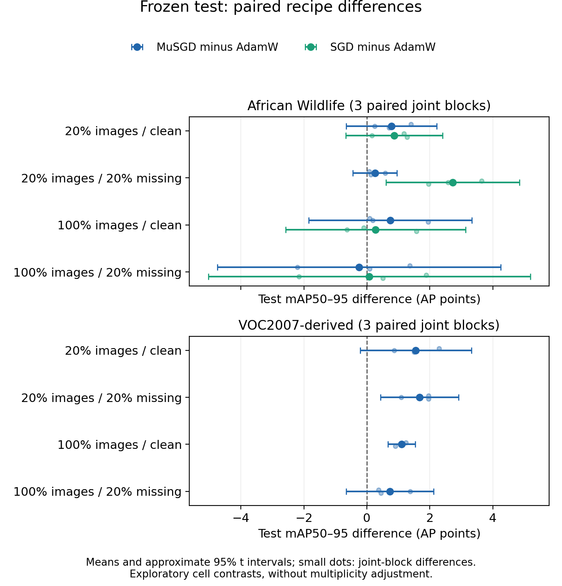

# MuSGD × YOLO26 under data scarcity and missing annotations

## Research manuscript

**Separating Training Exposure from Data Scarcity in MuSGD–YOLO Fine-Tuning under Missing Annotations**  
**Muchammad Yuda Tri Ananda** · [yuda@myudak.com](mailto:yuda@myudak.com) · October 2026

[**Read the paper (PDF)**](output/pdf/muon_yolo_scarcity.pdf) · [LaTeX source](paper/main.tex) · [Interactive Kaggle report](https://www.kaggle.com/code/myudak/muon-yolo-journal?scriptVersionId=364100382) · [Original experiment and outputs](https://www.kaggle.com/code/myudak/muon-yolo-journal?scriptVersionId=361947826)

An empirical comparison of existing MuSGD, AdamW and momentum-SGD fine-tuning recipes in pretrained YOLO26n. The study controls actual training exposure while varying available images and missing training boxes. This is a research manuscript; no journal acceptance or new optimizer is claimed.

## Findings

- **120 completed training trials** and **60 frozen-checkpoint test evaluations**, with no recorded failed or incomplete confirmation block.
- Primary runs each receive **20,480 image presentations and 1,280 optimizer updates**. Three paired joint blocks vary training, image-subset and annotation-deletion seeds together.
- MuSGD–AdamW test differences range from **−0.25 to +0.79 AP points on African Wildlife**, and **+0.73 to +1.67 on VOC-derived data**. SGD is a substantive wildlife comparator.
- The primary scarcity × missingness interaction is **+0.470 [−6.383, 7.322] AP points** on wildlife and **+0.488 [−0.660, 1.637]** on VOC-derived data. Both approximate 95% paired intervals include zero.
- **All selected learning rates are at the lower search boundary.** The prospective runtime rule skipped the planned extension. These are finite-grid-selected recipes, with three-block uncertainty; they do not establish universal optimizer superiority.

The VOC2007-derived task retains difficult objects and reports all-object **mAP50–95, not official VOC AP**. Validation and final test estimates are separate; the earlier untuned pilot is not pooled with journal confirmation.



See the [measured interpretation](research/JOURNAL_INTERPRETATION.md), [full paired estimates](research/JOURNAL_FINDINGS.md), and [frozen protocol](research/JOURNAL_PROTOCOL.md).

## Explore the results

The [public Kaggle report](https://www.kaggle.com/code/myudak/muon-yolo-journal?scriptVersionId=364100382) has five interactive charts: paired differences, absolute scores, the primary interaction, validation search and learning trajectories. Dropdowns select datasets, validation/test views, recipes, conditions and trajectory metrics. Hover reveals exact values and legend entries isolate series or blocks. It renders archived evidence on CPU; it does not rerun training.

For an offline copy, download [the interactive HTML explorer](output/kaggle_report/muon_yolo_results_explorer.html) and open the downloaded file in a browser. GitHub's file preview displays HTML source. The explorer includes its own plotting runtime and needs no Python session. Individual chart HTML files use the adjacent `plotly.min.js` bundle.

## What's in this directory?

| Path | Contents |
| --- | --- |
| [`output/pdf/`](output/pdf/) | The checked, ten-page manuscript PDF |
| [`paper/`](paper/) | Editable LaTeX, tables and numeric figures |
| [`src/`](src/) | Dataset variants, exposure control, training recipes and statistics |
| [`configs/`](configs/) | Pinned study settings and hash-bound duplicate exclusions |
| [`tests/`](tests/), [`analysis_tests/`](analysis_tests/) | CPU checks for data handling, pairing and analysis |
| [`research/`](research/) | Protocol, plan, run registry, findings and audit records |
| [`outputs/kaggle_journal_v1/muon_yolo_journal/`](outputs/kaggle_journal_v1/muon_yolo_journal/) | Frozen numeric evidence, data/variant manifests and per-run histories |
| [`kaggle/journal_public_report/`](kaggle/journal_public_report/) | Executed public report notebook and CPU publication metadata |
| [`notebooks/`](notebooks/) | Analysis companions and archived training notebooks |
| [`output/kaggle_report/`](output/kaggle_report/) | CSV/JSON exports and interactive HTML charts |
| [`release_manifest.json`](release_manifest.json) | SHA-256 identities of released files |

The evidence includes numeric records, source-image hashes and paths, rather than source photographs, individual image-label files or model weights. Private duplicate-review contact sheets and workstation tooling are omitted. Original checkpoints and predictions remain in the linked Kaggle version 1 outputs.

## Validate without training

From the monorepo root:

```bash
cd muon-yolo-scarcity
python -m pip install -r requirements-report.txt
python -m pytest -q tests analysis_tests
python scripts/audit_journal_evidence.py outputs/kaggle_journal_v1/muon_yolo_journal
python scripts/audit_journal_statistics.py outputs/kaggle_journal_v1/muon_yolo_journal
```

The evidence audit checks recorded plan/spec/data identities, actual exposure, finite histories, paired initialization/order and test-freeze linkage. The arithmetic audit independently recalculates 70 summaries and reconciles CSV/JSON metrics. These checks do not independently rehash omitted source-image or checkpoint bytes. Source files retain their frozen byte identities across Git checkouts.

To regenerate the CPU-only interactive report:

```bash
python scripts/build_public_journal.py
```

This writes an executed notebook under `kaggle/journal_public_report/` and regenerates `output/kaggle_report/`. It makes no Kaggle submission. Publishing scripts require separate explicit execution and authenticated credentials; credentials are not included.

## Training provenance

All GPU training ran on Kaggle. The preflight and original campaign had external caps totaling 12 hours; the original campaign's runner clock was 10.24 hours, excluding notebook installation and output persistence. Publication saves only render existing numeric results.

The [original version 1](https://www.kaggle.com/code/myudak/muon-yolo-journal?scriptVersionId=361947826) preserves executable training source and artifacts. The original plan and checkpoint/configuration freeze are included here. Test access has occurred; a new search must not be presented as a continuation of an untouched confirmatory test. The default launch helper refuses another campaign when the existing reserved cap is exhausted.

## Build the paper

The existing `paper/main.tex` is the manuscript entry point. For a local Tectonic installation:

```bash
tectonic --outdir output/pdf paper/main.tex
```

Tectonic writes `main.pdf`; the checked release is named `muon_yolo_scarcity.pdf`. The saved release was also compiled successfully in the desktop editor and all ten rendered pages were inspected. No journal-specific template has been selected.

## Attribution and data terms

African Wildlife and VOC images remain subject to upstream terms. The report contains numeric figures, and the release omits source photographs and weights. Upstream dependencies and models retain their own licenses; see [third-party notices](THIRD_PARTY_NOTICES.md). Publication of this directory does not relicense the datasets or model.

## Cite this manuscript

```bibtex
@unpublished{ananda2026musgdscarcity,
  author = {{Muchammad Yuda Tri Ananda}},
  title = {Separating Training Exposure from Data Scarcity in MuSGD--YOLO Fine-Tuning under Missing Annotations},
  year = {2026},
  note = {Research manuscript},
  url = {https://github.com/myudak/sandbox/blob/main/muon-yolo-scarcity/output/pdf/muon_yolo_scarcity.pdf}
}
```
