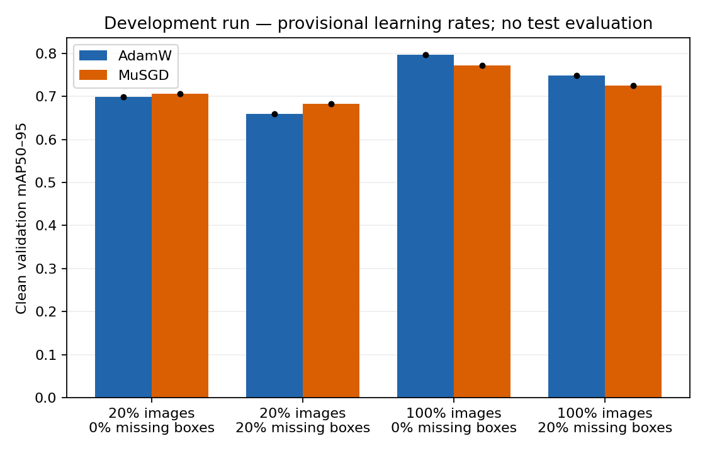
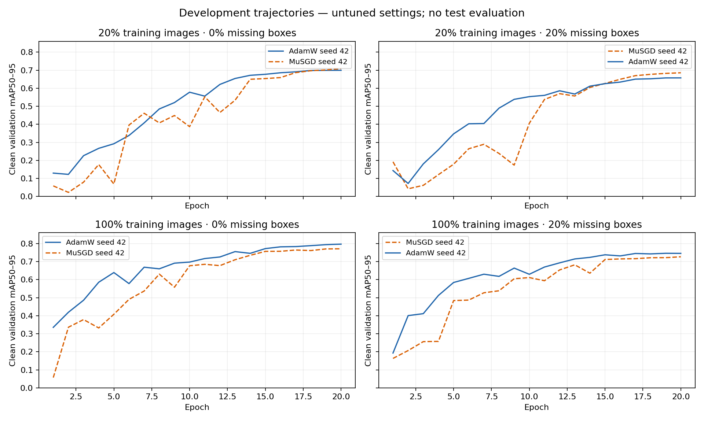

# Pilot findings — 25 October 2026

**Eight of eight runs completed on Kaggle**, using the reviewed 1,021/223/227 train/validation/test pool. All runs used YOLO26n, Ultralytics 8.4.187, one Tesla T4 device, seed 42, 20 epochs, 512 px, batch/nominal batch 16, zero warmup and the shared checkpoint. Test metrics were **not evaluated**.

This is a development pilot with **untuned learning rates** (AdamW 0.001, MuSGD 0.01). It compares the implemented library recipes, including MuSGD's selected 3× head LR and different update/decay behavior. It does not establish a general optimizer ranking.

## Clean-validation results

Values below are validation mAP50–95 multiplied by 100. Differences are AP points, MuSGD minus AdamW.

| Training images | Target missing boxes | AdamW | MuSGD | Difference |
|---:|---:|---:|---:|---:|
| 205 (20%) | 0% | 69.83 | 70.60 | +0.76 |
| 205 (20%) | 20% | 65.91 | 68.23 | +2.32 |
| 1,021 (100%) | 0% | 79.68 | 77.26 | −2.42 |
| 1,021 (100%) | 20% | 74.80 | 72.53 | −2.27 |

MuSGD's point estimate is higher in both scarce-data conditions, while AdamW's is higher in both full-data conditions. This reversal is **conditional on this seed, subset, corruption pattern, checkpoint, schedule and provisional hyperparameters**. There is no estimated between-seed uncertainty and no significance claim.

The descriptive optimizer × scarcity × noise contrast is **+1.413 AP points**: the noise-related change in the MuSGD–AdamW difference is +1.558 points at 20% data and +0.145 points at full data. The helper reports no confidence interval. The exact definition and values are in `paired_interactions.json` in the downloaded evidence.

## Convergence and budget interpretation

**Seven runs reached their best per-epoch validation value at epoch 20; the remaining run did so at epoch 19.** The study therefore does not establish converged quality. Independent evaluation of the saved best weights can differ slightly from the per-epoch trajectory.

At 20% data each optimizer made 260 updates and saw 4,100 images; at full data each made 1,280 updates and saw 20,420 images. These are matched **within** each condition, not across fractions. The current experiment does not isolate training-image availability from update exposure. A matched-update control is particularly relevant before interpreting the reversal as a property of scarcity itself.

The total training-call wall time was **28.40 minutes**. It includes training setup and the validation performed inside training, and excludes the separate post-training validation call and notebook/data setup. Cold-start costs affect the first run. These measurements support budget planning, not a matched-time speed ranking.

## Data and execution checks

- Both optimizers used the same variant fingerprint for each condition and identical initialized-model hashes. In fact all eight seed-42 initial states matched.
- All eight runs completed 20 epochs with finite histories and expected optimizer step counts. Actual training-loader counts matched the audited 205 or 1,021 images.
- CSV values matched JSON values. Configuration, source code and reviewed split fingerprints matched the local final files. The checkpoint hash matched the smoke run and recorded MuSGD pretraining lineage.
- At target 20% missingness, 72/385 annotated objects were deleted in the scarce subset (**18.70%**) and 361/1,881 in the full pool (**19.19%**). Images with all labels removed were retained.
- The official test membership was preserved. Retained validation/test labels stayed unchanged across all variants. Exact and reviewed near-duplicate exclusions are documented in `DATA_AUDIT.md`; the scene audit is not exhaustive.

## Implications for the paper

The pilot justifies investigating a **conditional recipe comparison**. It does not justify a claim that MuSGD universally improves robustness, that orthogonalization caused the pattern, or that the result will survive tuning/replication.

Before confirmation: decide whether the paper concerns short-budget adaptation or converged training; include matched-update and head-LR controls where feasible; tune all baselines fairly (including SGD); repeat paired training and data/corruption realizations; add an audited external dataset; and freeze the final test plan. Small held-out samples, possible source annotation errors, residual scene overlap, pretraining lineage and image licensing remain limitations.

## Evidence and reproducibility

- Private job: [Muon YOLO Pilot Reviewed](https://www.kaggle.com/code/myudak/muon-yolo-pilot-reviewed), version 1.
- Raw evidence directory: `outputs/kaggle_pilot_reviewed_v1/muon_yolo_pilot/` (manifest, CSV/JSON, per-run specifications, optimizer groups, histories and environment lock).
- Executed, self-contained analysis: [pilot_results_review.ipynb](../notebooks/pilot_results_review.ipynb), with an HTML export beside it.
- Numeric figures are provided as PNG and the trajectories also as SVG. The private project ZIP includes compact numeric evidence, without dataset photos or model weights.
- `RUN_REGISTRY.json` separates the current pilot from earlier superseded runs. None of the superseded scores are pooled here.
